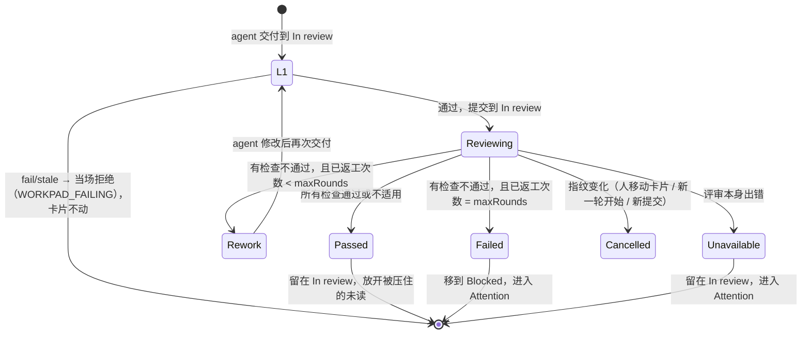

# 交付自动验收（AUTO-REVIEW-SPEC）

> 2026-10-28：本文部分内容被 [GUARDRAILS-SPEC](GUARDRAILS-SPEC.md) 取代（§12）。被取代：§1.1 用户路径、§4.1 L1、§4.2 的规则种类与 `types`、§6 全部配置、§7 Insights、§8.1 的 rules / guidance / reviewDraft、§8.4、§8.5 的多数 RPC、§9.2 的“Auto review 在 Workpad 之前、Workpad 默认收起”（评审现在是 Workpad 里的 Review 组，Workpad 默认展开）、§9.3、§9.6 的 What's new、§12 P3 的 2、4、5、D7、D8、D10、D11、D13–D16；仍有效：§2、§3、§4.3、§4.4 的 session 跑法、§4.5、§5、§8.2 骨架、§8.3、§9.1、§9.2 的 Rerun、§9.4、D1–D6、D9、D12、D17。

状态：P1、P2、P3 已实现，未提交（§12）。决定见 §11。卡片 `4286f00a`（Auto Review）。

## 1. 目标与用户路径

一句话：**打开 Auto review 后，agent 每次交付都先经过检查：Flowly 跑项目的检查命令，再由独立的评审者确认改动做到了用户在卡片和对话里要求的事；没做到就退回给 agent 返工，做到了才提醒用户。**

用户不需要设计规则。默认配置能直接用；卡片要查得更细时直接对 agent 说；规则随使用由 Insights 根据用户实际纠正过的事推荐。

### 1.1 用户路径

| 阶段 | 用户做的 | 用户看到的 |
| --- | --- | --- |
| 新用户 | 无 | 不推。导览 More features 里一句被动介绍（§9.6） |
| 新用户用了一阵，交付后常返工 | 在 Insights 点 **Set up auto review** | Insights 顶部：“最近 14 天交付的 N 张卡里，有 M 张交付后你又让 agent 改了”，附卡片（§7.1）。点击进入历史分析（§6.2） |
| 老用户升级到 1.8.0 | 在 What's new 点 **Suggest checks from past cards** | 当前项目的门禁总结与预选好的检查（§6.2） |
| 任何人主动打开 | Edit project → 打开 Auto review → 勾选识别到的命令 → Use these | 内置检查 + 识别到的命令（§6.1）；有足够历史时可点 **Suggest checks from past cards** |
| 日常 | 照常和 agent 干活 | 交付后卡面 “Reviewing 1/3”；通过后 Attention 提醒，抽屉先显示评审结果；没过时卡片自己回到工作阶段，agent 收到返工消息 |
| 复杂的卡 | 在会话里说“这个涉及迁移，重点查旧数据能不能读” | 内置检查读到这句话，按它判定（§4.2） |
| 返工到上限仍不过 | 回复 agent 或接手 | 卡片在 Blocked，Attention 显示 Review failed |
| 用了一阵 | 在 Insights 点 **Add check** | Insights 推荐由用户反复纠正长出来的检查，或建议暂停从没失败过的检查（§7.2） |
| 少数人细调 | 项目设置里编辑检查，或 **Adjust with AI** | 规则列表；设置卡片里与 agent 对话后 Apply 草案（§6.3） |

### 1.2 不做

人拖进 In review 时触发；评审 agent 改代码；多个评审者投票；CI/PR 状态接入（PR 自动化不在 v1 范围内）；外部推送；清除 Paseo 原生的回合结束提醒（D4）；临时 worktree 隔离（D6）；卡片自己的规则列表、评审等级、按改动路径触发的规则（D11）。

## 2. 复用与已知限制

| 需要 | 现有机制 | 用法 |
| --- | --- | --- |
| 交付时的 workpad 检查 | `openItems()` + `WORKPAD_OPEN` / `acknowledgeOpen`（WORKPAD-SPEC §5.3，`server/delivery-gate.ts`） | L1 在其上加硬拒绝 |
| 验证是否在当前代码上跑的 | `validationFreshness()`（`shared/workpad.ts`） | 直接用 |
| 交付前的阶段 | 进入 In review 的 `status_changed` 带 `from` | 退回目标（§3.2） |
| 退回后继续 | A1 回到最近的工作阶段（`resumeStage()`，`server/progress-rules.ts`） | 直接用 |
| 临时模型 session、结构化输出、超时、硬删除 | 摘要器：`agents.create({ outputSchema, labels })` + `runSummaryModels` + `summarizer-remove.ts` | 评审 session |
| 项目级的临时 session | Flowly background workspace（BACKGROUND-WORKSPACE-SPEC） | 历史分析（§6.2） |
| 给已有 session 发消息 | composer 的发送队列 | 返工投递 |
| 读 session 里用户的话 | `timeline.refetch({ projection: "projected" })` 的 `user_message`；项目记忆的线索（PROJECT-MEMORY-SPEC §4.0） | 内置检查、历史分析、返工提示 |
| 定期分析 | Insights 运行（INSIGHTS-REDESIGN-SPEC，WORKFLOW-INSIGHTS-SPEC §4） | 检查建议（§7.2） |

已知限制：

1. **Paseo 原生提醒拦不住。** 交付那一轮结束时 Paseo 会提醒 “agent 完成了”，这时评审还没开始；Flowly 只控制自己的 Attention，在卡片上标注评审状态（D4）。
2. **Paseo 脚本拿不到退出码。** 命令检查由 daemon 用参数数组直接起子进程。
3. **共享工作区会互相干扰。** 多张卡共用项目根目录时，命令测到的是所有卡的改动合在一起的状态。不隔离（D6），结果标注“共享工作区”，记录 sha 和 dirty。
4. **workpad 里的命令不自动执行。** 那是被评审的 agent 写的，照着执行等于让它绕过 Paseo 的权限确认。daemon 只执行项目规则里的命令，规则只能由用户写入或确认（§6）。

## 3. 流程与状态

### 3.1 触发

**agent** 调用 `flowly_update_status(in_review)`，通过 L1 并成功提交，项目开启了 Auto review，卡片未归档、不是设置卡片（§6.3），且有对这张卡生效的检查（§4.2）。人拖进 In review 不触发。

评审在**交付的那个 session 这一轮结束后**才开始（`agent.turn_ended`）；交付时该 session 已空闲则立即开始。交付之后同一轮里 agent 还可能提交、改 workpad，这些会改变指纹让评审作废。等待中的交付只记在内存里：等待期间插件重启，这次交付不评审，卡片留在 In review，人可以按 Rerun。



同一项目同一时间只跑一个评审（排队），因为它们的卡可能共用目录。

### 3.2 各状态

- **Reviewing**：卡片在 In review。这张卡在 Flowly Attention 里的**未读**信号暂不计入；权限请求、错误、提问照常计入。
- **Rework（R1）**：
  1. 退回目标 = 触发这次评审的交付事件的 `from`。它是 Design、Development 或 Test 且泳道开启时回到那里；否则（`from` 是非工作阶段、泳道已关闭、事件已被裁剪）按 `resumeStage()` 的 Blocked 分支取最近的工作阶段；仍没有时用第一个开启的工作阶段。
  2. 同一次写入里改状态（actor=system，`rule: "R1"`，task revision +1），**然后**发返工消息（§5）。状态先离开 In review，新一轮开始时 A1 就不会把卡改到 Development。
  3. 项目关闭 autoStatus 时 R1 照常运行。
- **Failed（R2）**：返工次数已达 `maxRounds` 仍不通过，不再发消息；卡片移到 Blocked（actor=system，`rule: "R2"`，note “Auto review failed after N rework rounds”），进入 Attention。Blocked 泳道关闭时留在 In review。之后用户在该卡 session 里回复，A1 照常把卡拉回最近的工作阶段。
- **Unavailable**：评审机制本身出错：工作目录不可用、命令起不来或超时、评审 session 失败或输出无法解析、返工 session 已不在、评审进行中 Flowly 重启。卡片不动（R1 之后投递失败时保持退回状态），进入 Attention 并显示原因。不计返工次数。
- **Cancelled**：开始时记录指纹（task revision、workpad revision、HEAD sha、dirty）。写结果前指纹变了就丢弃结果：不改状态、不发消息、不进 Attention。卡片仍在 In review 时显示 “Review cancelled”，可 Rerun。共享工作区里别的卡提交也会让 HEAD 变化而取消。
- 通过后从不自动移到 Done。

### 3.3 返工计数

- `round` 从 1 开始，每次 Rework 后再交付 +1；已返工次数 = `round - 1`。`maxRounds = 2` 表示最多自动返工 2 次、最多评审 3 次；`maxRounds = 0` 表示第一次不通过就进 Blocked。
- 重置为 1：上一次评审结束后人移动了卡片；该卡开始了不止一个回合（返工消息本身开始一个回合，多出来的是人发的消息）；上一次评审是 Passed/Failed/Unavailable/Cancelled；人按 Rerun。

## 4. 检查

### 4.1 L1 Workpad（同步，D3）

在 `flowly_update_status(in_review)` 里、交付提交之前计算。只在项目开启 Auto review 时生效。

| workpad 状态 | 结果 |
| --- | --- |
| 没有 workpad | 照现有 `SETUP_INCOMPLETE`（先拒后放） |
| 有 `fail` 的验证项 | 拒绝，`acknowledgeOpen` 无效 |
| 有 `stale` 的 pass | 拒绝，`acknowledgeOpen` 无效 |
| 有未勾选的验收标准，或 `unrun` 的验证项 | 照现有 `WORKPAD_OPEN`（先拒后放） |

错误码 `WORKPAD_FAILING`（不提交、不写回执、可重试）：“Auto review is on for this project: {n} workpad checks failed or are out of date: … Fix them and rerun the checks on the current code before delivering. acknowledgeOpen does not apply.” workpad 是 agent 的自报，L1 只拦 agent 自己承认的问题；它不是评审的尺子（D12）。

### 4.2 检查的种类

| 种类 | 由谁判定 | 内容 |
| --- | --- | --- |
| **内置检查 “Does what you asked”** | 评审 session | 固定，对照卡片标题、描述和用户在这张卡会话里说的话判断改动是否做到了（D12） |
| **命令检查** | daemon 跑命令，退出码 0 为通过 | `argv`、可选超时 |
| **LLM 检查** | 评审 session | `prompt`：一条具体、能从 diff 与卡片判断的要求 |

界面上统一叫“检查”，用图标区分命令与判断。

- **生效的检查**：内置检查（未暂停时）+ 没有 `off`、且 `types` 为空或包含卡片 type 的命令检查和 LLM 检查。卡片没有 type 时所有未暂停的检查都生效。
- 没有生效的检查时只有 L1，交付不启动评审。
- **内置检查的尺子**（按这个顺序给评审 session）：
  1. 卡片标题和描述；
  2. 用户在这张卡各 session 里发的消息：每个 session 的 projected timeline 末尾 200 条里的 `user_message`，去掉以 `[Flowly auto review` 开头的返工消息，按时间排列，保留最新的 30 条、合计不超过 12 000 字、每条不超过 1 500 字；读不到时写 “(conversation unavailable)”，照样评审；
  3. workpad（验收、验证、困惑点）与交付 note，标明 “the agent's own report, context only”。
- 内置检查的判定要求：较新的指示覆盖较早的；对话里说过先不做的不算缺；请求太含糊无法判断时判 `na`；不对照 workpad 判定。共享工作区（非 worktree，评审记录 `shared`）时另加一句：diff 里与本卡无关的改动可能属于别的卡，不据此判 fail，只在用户要求的事没做到或做错时判 fail。
- 内置检查不能删除，只能暂停（`goal: false`）。它的结果 id 固定为 `goal`，其他检查不能用这个 id。

### 4.3 命令检查的执行

- 评审开始时把生效的检查快照进评审记录；评审中改规则不影响这一次。
- 命令检查按列表顺序逐条执行，**全部跑完**，每条结束立即写回结果。
- daemon 在卡片 workspace 目录下用 `spawn`（参数数组，不经 shell，单独的进程组，超时整组 SIGTERM，5 秒后 SIGKILL）。环境变量加 `CI=1`、`NO_COLOR=1`、`FORCE_COLOR=0`。默认超时 600 秒（10–3600）。
- 退出码 0 为 `passed`；非 0 为 `failed`；超时或起不来为 `unavailable`（不算不通过）。
- 不通过或 unavailable 的那条保留最后 4 KiB 输出（去掉颜色码），只存在评审记录里，不写日志（可能含 token）。结果不写进 agent 的 workpad。
- 确实需要 shell 时由规则写成 `["sh","-c","…"]`；那是用户确认过的规则内容，不是 Flowly 拼接的。

### 4.4 评审 session（内置检查与 LLM 检查）

- 只在所有命令检查都 `passed`（或没有命令检查）时跑（D9）。有命令检查 `failed` 时，内置检查和 LLM 检查全部 `skipped`，原因 “Command rules failed.”；有 `unavailable` 时原因 “A command rule could not run.”。
- 一个临时 session 一次判定全部：建在卡片 workspace 里，父 session 为交付的 session，标签同摘要器（`flowly=summarizer`、`flowly-task`、`flowly-review=1`），结束后硬删除，删除失败时归档并记日志。超时 15 分钟。
- 模型：Settings → Models 的 **Review model**（`task-summary` 设置的 `reviewModel`）；未设置时用项目默认模型；再没有时用摘要模型列表。
- 输入：卡片标题、描述、type；内置检查的尺子（§4.2）；workpad；交付 note 与 outputs；命令检查结果摘要；项目 `guidance`；diff（`git diff HEAD` 加最近 5 个提交的 patch，截断到 64 KiB 并注明）；要判定的检查（id、name、prompt）。
- 指令：只读，不改文件，不运行会改变状态的命令；每条单独判定。
- 模式（2026-10-30）：`config.modeId = readOnlyMode(provider)`（`shared/summary.ts`）：`claude/*` 用 `plan`，其他 provider 不设（绝不用 full-access）。否则 Claude 评审 session 在 Always Ask 下第一次调用工具就停在权限确认，`runSummaryModels` 把它当失败，整轮评审 `unavailable`（“The summary model asked for a permission.”）。
- 输出（`outputSchema`，解析宽松：取第一个 JSON 对象，未知 id 和坏条目丢弃）：

  ```
  { rules: [{ id, verdict: "pass" | "fail" | "na", detail: string ≤ 600, file?: string, line?: int }] }
  ```

  `na` 按通过处理，显示 “Not applicable”。缺某条的 id → 那条 `unavailable`；session 超时、失败或输出无法解析 → 全部 `unavailable`。

### 4.5 总判定

有任何一条 `failed` → 不通过（R1 或 R2）；否则有 `unavailable` → Unavailable；否则 Passed。

## 5. 返工投递与 get_task

- 返工消息发给**交付的那个 session**；它已被归档或删除时不投递，按 Unavailable 处理（卡片保持 R1 退回后的状态）。session 正在运行时排队，等这一轮结束再发。
- 消息格式（固定标识开头，与普通 follow-up 区分）：

  ```
  [Flowly auto review · rework 1/2]
  Commands: 1/2 passed
  ✗ Unit tests (npm test) exited 1:
      expected 410, got 404 (links.test.ts:88)
  LLM review: skipped (command rules failed)
  Fix these, rerun the affected checks, update the workpad and deliver to In review again.
  ```

  命令都通过、判断类检查有不通过时，按 `✗ <name>: <detail> (<file>:<line>)` 逐条列出。
- `flowly_get_task.review`：state、round、maxRounds、reason、startedAt、finishedAt，以及每条检查的 id、kind、name、state、command、exitCode、timedOut、tail（≤ 2000 字）、detail、file、line、reason。`task` 里不重复这份记录。
- `flowly_get_task.reviewRules`（项目开启时）：对本卡生效的检查（含内置检查是否开启）、`maxRounds`，以及只在其中有判断类检查时才带的 `guidance`。设置卡片和当前草案的来源卡片拿全部检查（含暂停的和 `types`）与 `guidance`，并附草案全文；其他卡片有草案时只附来源卡片和时间。设置卡片和草案来源卡片即使项目关闭也带。
- skill 和 `flowly_update_status` 的说明写明 `WORKPAD_FAILING` 与返工消息：先处理这些意见；评审会对照用户在会话里的要求。

## 6. 配置

### 6.1 打开开关与命令识别（D13）

- 在 Edit project 打开 Auto review 时，项目还没有任何命令检查，就调用 `reviews.detect-commands` 从项目根目录识别检查命令，不调用 LLM、不执行命令：

  | 依据 | 识别 | 默认勾选 |
  | --- | --- | --- |
  | `package.json` 的 scripts，包管理器按锁文件（`pnpm-lock.yaml` → pnpm，`yarn.lock` → yarn，`bun.lockb`/`bun.lock` → bun，否则 npm） | 名为 `typecheck`/`type-check`/`tsc`、`lint`、`test` 的脚本：`[pm, "run", name]` | 是 |
  | 同上 | `build`、名字含 `e2e` 的脚本 | 否 |
  | `Cargo.toml` | `cargo test` | 是 |
  | `go.mod` | `go vet ./...`、`go test ./...` | 是 |
  | `pyproject.toml` / `pytest.ini` / `setup.cfg` 提到 pytest | `python -m pytest` | 是 |
  | `Makefile` 有 `test`、`lint`、`check` 目标 | `make <target>` | 是 |

  最多 6 条，名字带 `watch` 的脚本跳过。
- 界面在开关下方列出：内置检查（固定在第一行）和识别到的命令（复选框），按钮 **Use these**。勾选的命令写入规则后随 Save 保存（项目 revision +1）。用户勾选就是同意 daemon 执行这些命令。
- 一条都没识别到时只显示内置检查。
- 项目在近 90 天有 ≥ 5 次 agent 交付时，同一位置还有按钮 **Suggest checks from past cards**（§6.2）。

### 6.2 历史分析与门禁总结（D15、D16）

**入口**：What's new 1.8.0 的按钮（当前项目）；项目设置的 Suggest checks from past cards；Insights 返工提示的 Set up auto review（§7.1）。三处都打开该项目的 Edit project 并开始分析；从 What's new 和 Insights 打开时 Auto review 区块排在表单最前面（宿主的弹窗不提供滚动定位）。

**条件**：近 90 天 ≥ 5 次 agent 交付。不满足时不调用模型，显示 “Not enough past deliveries in this project yet.” 和 §6.1 的识别结果。同一项目同时只跑一个分析；已有分析在跑时显示进度。

**统计（daemon，确定性）**：

- 交付：agent 把卡移到 In review 的 `status_changed`。
- **交付后返工**：卡在 In review 时，用户的消息开始了一轮（A1，`from: in_review`），而且那一轮结束时没有被 A1r 还原（那一轮确实做了事）。“提交并推送”这种不干活的回合会被 A1r 还原，不计入。
- 门禁总结的数字（交付卡数、交付后返工卡数）由 daemon 算，不信模型。

**分析 session**：在项目的 Flowly background workspace 建临时 session（同 Insights：用前恢复或复用，用完归档 workspace；session 结束后硬删除），模型同 Insights 设置的模型，超时 15 分钟。

- 素材（总长 ≤ 100 000 字）：
  1. 近 90 天交付过的卡：短 ID、标题、type、标签、最新卡片总结的 recap（≤ 400 字）、是否交付后返工；
  2. 返工那一轮用户的原话：项目记忆在那一轮采集的线索（`feedback`、`message`，每卡 ≤ 3 条、每条 ≤ 400 字）；项目记忆关闭时写 “(memory off)”；
  3. workpad 里出现过的检查命令及出现的卡数；
  4. §6.1 识别到的命令；`AGENTS.md`/`CLAUDE.md` 的 Commands 一节（≤ 4000 字）；
  5. 当前规则（名称、命令或 prompt）。
- 指令：把交付后返工的原因归类；只为能防止**至少 2 张卡**返工的原因提检查；能由退出码判断的写成命令检查（优先用仓库已有脚本），其余写成一句可判断的 LLM 检查；不重复内置检查和已有规则；最多 6 条。
- 输出：

  ```
  { reasons: [{ title, cards: string[], quote?: string }],              // 返工原因，≤ 6
    checks:  [{ rule: Rule, cards: string[], why: string ≤ 300 }] }    // Rule 同 §8.1，≤ 6
  ```

- 校验：`cards` 必须是素材里的卡，`reasons` 的卡必须是交付后返工的卡；少于 2 张卡的条目丢弃；`rule` 按 §8.1 校验，id 与现有规则冲突时加序号；不合法的丢弃，不截断。全部丢弃时显示总结、没有新检查。
- 结果写成项目草案（§6.4），`by: { analysis: true }`：`rules` = 当前规则 + 新检查；`added` 列出新检查的 id，每条带 `cards` 与 `why`；`summary` = `{ delivered, reworked, reasons, dropped? }`。写草案前按“当前规则 + 新检查”逐条判断每类 10 条的上限，放不下的新检查丢掉，`dropped` 记丢掉的条数，界面显示 “N suggested checks did not fit: a project holds at most 10 of each kind.”；分析本身不因此失败。
- 返工回合里用户的原话（素材 2、§7.1 的引用、§7.2 的素材）：项目记忆线索中 `feedback`、`message` 两类，时间从这一轮的 A1 起，到该卡下一次 `agent.turn_started` 为止（没有下一轮就到现在）。线索在回合结束之后才写入，所以不能以 `turn_ended` 为界。

**界面**（Auto review 区块内）：

```
过去 90 天交付 34 张卡，其中 9 张交付后你又让 agent 改了
  测试没跑或没过      4 张  #a1b2 #c3d4 …
  新文案没进所有语言  3 张  #e5f6 …「新文案也要进所有语言」

检查
 ✦ Does what you asked
 ☑ Typecheck           npm run typecheck
 ☑ Unit tests          npm test             4 张卡
 ☑ 新文案进所有语言目录                      3 张卡
[Use these and turn on]                [Adjust with AI]
```

卡片引用可点击，打开卡片。新检查默认勾选，取消勾选的在 Apply 时不加入。开关关闭时，§6.1 识别出的命令也并入这个列表（内置检查、识别出的命令、分析给出的检查依次排列，命令同样可取消勾选），只有一个按钮 **Use these and turn on**；勾选的命令随 Apply 一起写入（`apply-draft` 的 `add`）。还没有分析结果时（交付不足、分析失败、分析中）仍按 §6.1 单独显示识别块。分析中显示 “Analyzing past cards… uses tokens”，失败时显示原因，可重试。

### 6.3 Adjust with AI（设置卡片，D7）

- 项目设置的 **Adjust with AI** 按钮（开关关闭时也显示）。项目已有未归档的设置卡片时打开它，否则新建：标题 “Auto review setup”，type `chore`，建在 Design（泳道关闭时用第一条开启的泳道），`task.reviewSetup: true`。daemon 同时建 session：模型取项目默认模型，其次 Settings → Models 的默认模型，都没有时 `claude/claude-haiku-5-5`；第一条消息是设置说明。点击后打开这张卡的抽屉。session 没能启动时卡片照样建好，提示从卡片里启动。
- 设置卡片交付时不启动评审（它不改代码，要验收的是草案）；L1 照常。
- **设置说明**（英文，agent 读）要求 agent：先读仓库（脚本、CI、`AGENTS.md`/`CLAUDE.md`/`CONTRIBUTING.md`、README）和 `get_task.reviewRules`；用提问工具问用户想在交付时把住什么；能由退出码判断的写成命令检查、优先复用仓库脚本，需要判断的才写成 LLM 检查，每条只管一件事；每条命令在 workspace 里试跑一次，在说明里写出结果和耗时，跑不通的不放进草案；建议 `types`；内置检查已覆盖“做到了用户要求的事”，不要重复；用 `flowly_propose_review_rules` 提交完整列表，用户要改就再提交一次；不改仓库文件，缺检查脚本时先问用户，同意后作为这张卡的普通改动来做。
- **工具** `flowly_propose_review_rules`（MCP 与 CLI `review-rules`，任何卡片的 session 都可调用）：参数 `request`、`expectedRevision`、`rules`（完整列表，§8.1）、`guidance?`、`maxRounds?`、`goal?`（内置检查开关）、`note`（≤ 1000）。校验失败返回 `REVIEW_RULES_INVALID`，列出全部问题，不写入。成功时写入项目草案（§6.4），`by: { taskId, agentId }`，返回与当前规则的差异（新增、修改、删除的 id）。

### 6.4 草案与 Apply（D8）

- 每个项目一份草案，新的覆盖旧的。写入不改项目 revision，不会让其他 agent 的上下文过期。
- 有草案时，项目设置 Auto review 区块顶部显示草案；来自设置卡片的草案也显示在该卡抽屉里。内容：逐条新增、修改（前后对比）、删除，agent 的说明或历史分析的总结；按钮 **Apply**（开关关闭时为 “Apply and turn on”）、**Discard**。
- 草案以 `at` 标识（每次写入都不同，至少比上一份晚 1 ms）。Apply 和 Discard 都带上界面显示的那份草案的 `at`；与当前草案不一致或草案已不存在时返回 `status: "stale"`、不写入，界面刷新草案并提示 “The agent proposed a new draft. Review it before applying.”。
- Apply 可带 `exclude`：不加入的新检查 id（只能是草案 `added` 里的）。用草案替换项目的 `rules`、`guidance`、`maxRounds`、`goal`（草案里有的字段），开启 Auto review，项目 revision +1，清除草案，关闭项目设置。
- 草案的 `baseHash`（提出时规则、guidance、maxRounds、goal 的哈希）与当前不同，说明规则在草案之后改过：Apply 先返回 `status: "confirm"`，界面提示“应用会覆盖这些改动”，确认后才写入。
- Discard 只清除草案。应用或丢弃都不通知 agent。

### 6.5 手动编辑

项目设置的检查列表（§9.3）可以直接加、改、删、暂停，随 Save 保存，不经草案。

## 7. Insights

### 7.1 返工提示（D14）

- 条件全部满足时，Insights 页顶部显示返工提示：项目没开 Auto review；近 14 天至少 3 张卡交付后返工（§6.2 的定义）；30 天内没点过 Not now。数字和卡片由 daemon 在读 Insights 时算出，不依赖 Insights 的模型运行或开关。
- 内容：

  ```
  最近 14 天交付的 12 张卡里，有 5 张交付后你又让 agent 改了
    #a1b2 Add link expiry「新文案没进所有语言」  #c3d4 …
  Auto review 可以在交付前先把这类问题查出来，没过就自动退回。
    [Set up auto review]   [Not now]
  ```

  每张卡附返工那一轮项目记忆采集的用户原话（有时，≤ 60 字），最多 3 张。
- Set up auto review → §6.2。Not now → 记下时间，30 天内不再显示。
- 一次性提示 `review-suggest`：项目有返工提示且没打开 Insights 时，指向 Insights（§9.6）。

### 7.2 检查建议

在 Insights 的定期运行里（与 Skills 同一次模型调用，开关、周期、模型、替换规则都沿用 INSIGHTS-REDESIGN-SPEC），项目开启了 Auto review 时加一类建议 `review_rule`：

- 素材加一节 “Auto review”：当前规则（名称、命令或 prompt 首行）；窗口内各条检查的评审次数与失败次数；交付后返工的卡与那一轮用户的原话；返工消息里反复出现的失败。
- 指令：只为已有规则没覆盖、且在至少 2 张卡上让用户返工或让评审失败的原因提检查；说过（AGENTS.md、记忆、skill）仍然反复出错的优先；最多 3 条。
- 每条建议带一条规则（按 §8.1 校验）和依据的卡片；与现有规则（名称或 prompt 相似）、30 天内 dismissed 的建议重复的丢弃。
- 界面在 Insights 的 “Auto review” 区块：

  ```
  4 张卡交付后，你都要求补全多语言词条
    #a1b2 #c3d4 #e5f6 #0a9b ·「新文案也要进所有语言」
    检查：每个新加的界面文案都出现在所有语言目录里
    [Add check]  [Dismiss]
  ```

  命令类建议显示完整命令。**Add check** 把这条规则加进项目（id 冲突时加序号，项目 revision +1），建议标为 accepted。同类检查已满 10 条时不写入，返回 “This project already has 10 LLM checks. Remove one first.”（命令类同理），建议保持 open。
- **暂停建议**（确定性，不经模型）：一条未暂停的 LLM 检查（不含内置检查）近 30 天被判定 ≥ 20 次且从没失败 → “<name> passed all 20 reviews. Pause it to save tokens?” [Pause] [Dismiss]。在项目每次 Insights 运行成功后计算；同一条检查已有 open、accepted 或 30 天内 dismissed 的暂停建议时不再提。

## 8. 数据

### 8.1 项目

```
project.autoReview?: {
  enabled: boolean,                        // 默认 false
  maxRounds: int 0–5,                      // 默认 2
  goal?: boolean,                          // 内置检查，缺省为开
  rules: Rule[],                           // 命令检查 ≤ 10，LLM 检查 ≤ 10
  guidance?: string,                       // ≤ 4000，只给评审 session 看的项目背景
}
Rule = {
  id: string,                              // 1–40 位 [a-z0-9-]，项目内唯一，不能是 "goal"
  name: string,                            // ≤ 80
  types?: TaskType[],                      // 只对这些类型的卡生效；不填为全部（D10）
  off?: true,                              // 暂停
} & ( { kind: "command", argv: string[], timeoutSec?: 10–3600 }   // argv ≤ 30 项，每项 ≤ 500
    | { kind: "llm", prompt: string } )                            // ≤ 2000

project.reviewDraft?: {
  rules: Rule[], guidance?, maxRounds?, goal?,
  note: string,                            // ≤ 1000；agent 的说明
  by: { taskId, agentId } | { analysis: true },
  added?: [{ id, cards: string[], why }],  // 历史分析新加的检查
  summary?: { delivered, reworked, reasons: [{ title, cards, quote? }], dropped? },
  at, baseRevision, baseHash,
}
```

- 草案写入不改项目 revision；`autoReview` 的修改（Save、Apply、Add check）改项目 revision。
- **迁移**：只有 P1 `checks` 的项目读成命令检查（`id` 由名称生成，重名加序号），下一次保存时改写成 `rules`；无效的旧数据保留，不重置。

### 8.2 卡片

- `task.reviewSetup?: true`：设置卡片。
- `task.review`：最近一次评审，新的覆盖旧的；写入不改 task revision。

```
Review {
  trigger: { eventId, agentId, from },     // 人按 Rerun 时 eventId 为空
  round: int ≥ 1, maxRounds: int 0–5,
  state: "running" | "passed" | "rework" | "failed" | "unavailable" | "cancelled",
  reason?: string,                         // ≤ 500
  fingerprint: { taskRevision, workpadRevision, sha?, dirty },
  shared: boolean,                         // 非 worktree
  rules: [{ id, kind: "command" | "llm", name,
            state: "queued" | "running" | "passed" | "failed" | "na" | "skipped" | "unavailable",
            ms?, argv?, exitCode?, timedOut?, tail?,   // tail ≤ 4 KiB，只在 failed/unavailable 时
            detail?, file?, line?,                     // 判定理由，passed 时也保留
            reason? }],                                // skipped/unavailable 的原因
  model?: string,
  startedAt, finishedAt?
}
```

- 开始时所有检查为 `queued`，命令逐条变 `running` 再变结果；判断类检查在评审 session 运行期间一起为 `running`，结果一起写回。内置检查的条目 `id: "goal"`、`kind: "llm"`、`name: "Does what you asked"`。
- 插件启动时仍为 `running` 的评审改为 `unavailable`（“Flowly restarted during the review.”）。

### 8.3 事件

`review_started`；`review_finished`（note 写结果摘要，另带 `results: [{ id, state }]` 供 Insights 统计）；`status_changed` + `rule: "R1"` / `"R2"`；`review_rules_proposed`（agent 提交草案）。活动时间线显示 “Auto review” 标签。

### 8.4 Insights

`workflow-insights.json`：`findings[].target` 加 `review_rule`，带 `rule` 字段；暂停建议同样作为 finding 存（`target: "review_pause"`，`ruleId`，`title` 为规则名，`reviews` 为判定次数）；新增 `reviewNudges: { [projectId]: { dismissedAt } }`。`review_rule` 与 `review_pause` 自成一类，Insights 新一次运行只替换这一类里仍为 open 的建议，不影响技能草案和其他建议。

### 8.5 RPC

| 名称 | 输入 | 输出 |
| --- | --- | --- |
| `reviews.rerun` | `{ taskId }` | `{ ok }`；卡片须在 In review、项目开启且有生效的检查、没有评审在跑 |
| `reviews.detect-commands` | `{ projectId }` | `{ commands: [{ name, argv, checked }] }` |
| `reviews.analyze-history` | `{ projectId }` | `{ status: "started" \| "running" \| "insufficient" }` |
| `reviews.analysis-status` | `{ projectId }` | `{ state: "idle" \| "running" \| "failed", error?, startedAt?, eligible }`（只在内存里，daemon 重启后为 idle；`eligible`：近 90 天 ≥ 5 次 agent 交付，决定是否显示 Suggest checks from past cards） |
| `reviews.apply-draft` | `{ projectId, at, confirm?, exclude?, add? }`（`add`：勾选的识别命令 `[{ name, argv }]`，作为命令检查加入；已有同样命令或超出上限的跳过） | `{ status: "applied", revision } \| { status: "confirm" } \| { status: "stale" }` |
| `reviews.discard-draft` | `{ projectId, at }` | `{ status: "discarded" \| "stale" }` |
| `reviews.setup-card` | `{ projectId }` | `{ taskId, created, sessionError? }` |
| `insights.add-review-check` | `{ findingId }` | `{ revision }`；建议须为 open |
| `insights.pause-review-check` | `{ findingId }` | `{ revision }` |
| `insights.dismiss-review-nudge` | `{ projectId }` | `{ ok }` |

## 9. 界面与提醒

### 9.1 卡面

卡片有评审记录且仍在这一轮里时：

- `Reviewing n/N`（In review，进行中）：卡片底部展开指示条（图标 + 文字 + 运行中卡片同款点阵扫光，跟随 Reduce Motion 和扫光开关），开始时展开、结束时收起；n 为已结束的检查数。
- `Review passed`（In review）、`Reworking 1/2`（退回后的工作阶段）、`Review failed`（Blocked，或 Blocked 泳道关闭时的 In review）、`Review unavailable`（In review，或 R1 之后投递失败时的工作阶段）、`Review cancelled`（In review）。
- 卡片的无障碍标签带上评审状态。

### 9.2 抽屉（D17）

- （2026-10-28 删除：原“项目开启 Auto review 时 Auto review 区块放在 Workpad 之前、Workpad 默认收起”。评审现在是 Workpad 里的 **Review** 组，Workpad 按用户的抽屉默认展开，见 GUARDRAILS-SPEC §7.1。）
- Auto review 区块：分 **Commands** 和 **LLM review** 两组（内置检查在 LLM review 组第一行），每组标题右侧 “通过数/条数”；每行状态图标、名称、耗时。`failed` 行展开显示命令输出末尾或判定理由与文件位置；`passed` 的判断类检查点开可看理由；`skipped`、`unavailable` 行显示原因；共享工作区时注明。评审中逐条更新（沿用卡片详情的 etag 读取，不新增轮询）。
- 卡片在 In review、项目开启且有生效的检查、没有评审在跑时有 **Rerun**（round 重置为 1，返工发给最近一次交付的 session）。
- 设置卡片的抽屉显示项目草案（§6.4）。

### 9.3 项目设置（Edit project → Auto review）

```
Auto review                                   [开]
  Every delivery runs an LLM review and uses tokens.
  <草案块，有草案时>
  检查
   ✦ Does what you asked                       [暂停]
   ▶ Typecheck        npm run typecheck
   ▶ Unit tests       npm test
   ◆ 新文案进所有语言目录 · feature, bugfix
  [Add check]  [Suggest checks from past cards]  [Adjust with AI]
  Review guidance                                （有判断类检查时）
  Max rework rounds  2
```

- 开关关闭时只显示开关、草案块（有时）和 Adjust with AI；打开时首次进入 §6.1 的识别流程。
- 成本那一行只在内置检查或 LLM 检查开着时显示（成本信息）。
- 每行：名称；副行在有内容时显示命令原文或 prompt 首行与类型过滤；暂停的淡显。点行编辑：名称、种类、命令（一行，按空格切分，引号内空格保留，不是 shell）或 prompt（多行）、类型（多选）、暂停、删除。内置检查只能暂停。
- Suggest checks from past cards 只在开关打开、且项目近 90 天 ≥ 5 次 agent 交付时显示（开关关闭时从 What's new 或 Insights 进入）。分析失败后同一按钮显示为 Retry。

### 9.4 Attention

- 新原因：review failed、review unavailable（只在卡片还停在该评审留下的位置时）。信号 key `review:<state>:<startedAt>`，供 Dismiss 判断“有新信号”（ATTENTION-DISMISS-SPEC §2.2）。Review failed 与提问、权限一样排在前面。
- 通过不是单独的原因：评审期间压住的未读在通过后放开，Mark as read 照常清掉。

### 9.5 Insights 页

返工提示（§7.1）在页面顶部；检查建议与暂停建议（§7.2）在 “Auto review” 区块，位置在 Skills 之后、其它建议之前；没有建议时整块不显示。

### 9.6 引导、What's new、遥测、i18n

- **新用户**（D14）：导览 More features 一行被动介绍，不带按钮：“Auto review: deliveries are checked before they reach you, and go back to the agent when they fall short.” 一次性提示：`auto-review`（项目里有卡片显示评审状态且没打开卡片时，排在 next-move 之后、first-workpad 之前）；`review-suggest`（§7.1，排在 `first-skill-draft` 之前）。`tipIds`、`tipText`、`nextTip`、onboarding-logic 测试与 ONBOARDING-SPEC 提示表一起改。
- **老用户**（D15）：What's new 1.8.0 一条：“Auto review: deliveries are checked before they reach you, and go back to the agent when they fall short. Flowly can suggest the checks from your past cards.” 按钮 **Suggest checks from past cards**（新按钮动作：打开当前项目的 Edit project 并开始 §6.2）。
- **遥测**：`f_auto_review`（有未归档项目开启了 Auto review）；`f_auto_review_llm`（其中有开着的内置检查或未暂停的 LLM 检查）。TELEMETRY-SPEC §4.2 与 key-set 测试同步改定义；不加新字段。
- **i18n**：新文案进所有目录；规则名、prompt、guidance、草案说明、分析总结是用户或模型写的内容，不翻译；内置检查名在渲染时翻译，存储为英文。

## 10. 与产品约束的对照

| 约束 / 已有决定 | 处理 |
| --- | --- |
| “Automatic assignment, multi-agent handoffs, role orchestration… are outside v1” | 用户 2026-10-27 批准例外（D1、D2），已写进 AGENTS.md Product invariants |
| “ordinary follow-up sends exactly the user's text” | 返工消息是带固定标识的自动验收投递，不是普通 follow-up（D2） |
| project memory `8424d1ab`：否决服务端自动给会话发补登消息 | 那条针对补救 agent 漏做的流程步骤；返工消息是质量验收的结果，用户确认允许（D2） |
| “A turn ending never automatically completes the card.” | 只由交付事件触发；通过不进 Done；R1/R2 只移到工作阶段或 Blocked |
| 临时 session 硬删除、Flowly background workspace 的例外 | 评审 session 已在 Auto review 例外里；**历史分析 session（§6.2）需加入 AGENTS.md 里 background workspace 与硬删除两条例外的名单**（实现 P3 时一起改） |
| “Use subprocess argument arrays, never shell interpolation” | 命令检查只接受 argv |
| “Do not expose tokens … in logs” | 命令输出只存在评审记录里（截断），不进日志 |
| UI 文案规则 | 只保留成本、状态和不明显的后果；规则名等由用户内容填充 |
| Onboarding upkeep | 导览一行、两个提示、What's new 一条（§9.6） |

## 11. 决定

| # | 问题 | 决定 |
| --- | --- | --- |
| D1 | 是否允许 Flowly 自动创建评审 session | 允许（2026-10-27） |
| D2 | 不通过时是否自动给原 session 发返工消息 | 自动发；上限在项目设置里改；达到上限仍不通过移到 Blocked 并进入 Attention（2026-10-27） |
| D3 | L1 的 fail/stale 当场拒绝还是交付后打回 | 当场拒绝（2026-10-27） |
| D4 | 评审期间是否清除 Paseo 原生提醒 | 不处理；在卡片上标注评审状态（2026-10-27） |
| D5 | 退回到哪个阶段 | 交付前所在的工作阶段（2026-10-27） |
| D6 | 共享工作区是否在临时 worktree 里跑命令 | 不隔离（2026-10-27） |
| D7 | 与 LLM 对话配置规则的会话放在哪 | 专用设置卡片，作为次要入口 Adjust with AI（2026-10-28）。否决：项目设置里的独立聊天面板 |
| D8 | agent 或分析提出的规则怎么生效 | 草案 + 用户 Apply（2026-10-28）。否决：agent 确认后直接写入（之后每次交付都会自动执行这些命令） |
| D9 | 命令检查有失败时是否还跑评审 session | 跳过（2026-10-28） |
| D10 | 规则能否按卡片类型限定 | 可选的类型过滤，不填为全部（2026-10-28） |
| D11 | 卡片级的要求怎么表达 | 不设卡片规则；评审读用户在卡片会话里说的话（2026-10-28）。否决：卡片追加规则 + 草案 + Apply（概念多，用户不知道怎么用）；评审等级 Thorough、按路径触发（先不做） |
| D12 | 评审的尺子 | 内置检查 “Does what you asked”：卡片标题、描述和用户原话；workpad 是 agent 自报，只作参考（2026-10-28）。否决：默认规则 “Workpad acceptance met”（考生自己出题） |
| D13 | 打开开关时怎么给出命令 | 从仓库确定性识别，用户勾选确认，不用 LLM（2026-10-28） |
| D14 | 新用户怎么接触 | 不主动推；导览一句被动介绍；交付后返工多时 Insights 提示（2026-10-28） |
| D15 | 老用户怎么接触 | What's new 1.8.0 带按钮，用过往卡片生成门禁总结和预选检查（2026-10-28） |
| D16 | AI 怎么推荐规则 | 一个历史分析：升级按钮、设置按钮、返工提示进入同一分析；Insights 定期运行推荐增量检查（2026-10-28） |
| D17 | 开启后用户读什么 | 抽屉以评审结果为主，Workpad 默认收起（2026-10-28） |

## 12. 分期

1. **P1（已实现）**：L1、命令检查、评审记录、卡面状态与 Attention、R1/R2、返工投递、项目设置。
2. **P2（已实现）**：规则列表（命令 + LLM、类型过滤、暂停）、设置卡片与草案（`at` 核对、`baseHash` 确认）、评审 session、Review 模型、逐条结果、`get_task.reviewRules`。
3. **P3（未实现）**：
   1. 内置检查与用户原话输入（§4.2、§4.4），设置说明去掉 “Workpad acceptance met”；
   2. 命令识别与 Use these（§6.1），设置界面按 §9.3 调整，Set up with AI 改名 Adjust with AI；
   3. 抽屉以评审结果为主（§9.2）；
   4. 历史分析与门禁总结（§6.2），草案扩展（§8.1），What's new 按钮（§9.6）；
   5. Insights 返工提示、检查建议、暂停建议（§7），`review_finished.results`；
   6. 引导与提示（§9.6），AGENTS.md 例外名单（§10）。

## 13. 验收

### 13.1 P1、P2（回归）

- 项目开启后，agent 交付时 workpad 有 fail 或 stale → `WORKPAD_FAILING`，带 `acknowledgeOpen=true` 也拒绝，卡片不动；项目关闭时与以前一致。
- agent 交付 → 该 session 这一轮结束后开始评审，期间该卡不因未读进入 Attention；通过后显示 Review passed，未读照常进入 Attention。
- 从 Test 交付、一条命令退出码非 0 → 回到 Test，Reworking 1/N，原 session 收到带标识的返工消息，`get_task.review` 有意见；A1 没有把卡改到 Development。
- 已返工 `maxRounds` 次后再次不通过 → Blocked、Review failed、Attention，不再发消息；`maxRounds = 0` 时第一次就进 Blocked；Blocked 泳道关闭时留在 In review。
- 评审进行中人拖动卡片、发消息或有新提交 → 结果丢弃；仍在 In review 时显示 Review cancelled，可 Rerun。
- 命令不存在、超时、评审 session 失败、原 session 已归档 → Review unavailable，不计返工次数。
- 三条命令中第二条失败：三条都跑完（passed、failed、passed），判断类检查全部 skipped，按 R1 退回。
- 评审 session 输出缺一条 → 那条 unavailable；其余都通过 → Review unavailable。
- 评审 session 结束后被硬删除。人拖进 In review 不触发；设置卡片交付不触发。
- 草案：不合法 → `REVIEW_RULES_INVALID`；Apply 替换规则、项目 revision +1、开启 Auto review；看着草案 A 时又来了 B → Apply/Discard 返回 stale；规则在草案之后改过 → 先 confirm。
- `types: ["bugfix"]` 的检查在 feature 卡上不跑；`off` 的不跑。
- P1 的 `checks` 读成命令检查，保存后写成 `rules`。

### 13.2 P3

- 项目开启 Auto review、没有其他检查：交付后只跑内置检查；评审 session 的输入里有卡片标题、描述和用户在会话里的消息（不含返工消息），workpad 标为 agent 自报。
- 用户在会话里先要求 A、后说“A 先不做”：改动没做 A 时内置检查不因 A 判 fail。
- 内置检查暂停（`goal: false`）且没有其他检查：交付不启动评审。
- 打开开关：TS 项目（有 `pnpm-lock.yaml` 和 typecheck、lint、test、build、test:watch 脚本）识别出 `pnpm run typecheck`、`pnpm run lint`、`pnpm run test`（勾选）和 `pnpm run build`（不勾选），不含 test:watch；Use these 后随 Save 写入；识别不执行任何命令。
- 近 90 天交付不足 5 次：Suggest checks from past cards 不显示；从 What's new 进入时显示 “Not enough past deliveries…” 和识别结果，不调用模型。
- 历史分析：交付后返工的统计排除被 A1r 还原的回合；结果写成 `by: { analysis: true }` 的草案，`summary` 的数字等于 daemon 统计；少于 2 张卡依据的检查被丢弃；取消勾选一条后 Apply，它不在规则里；分析 session 被硬删除，background workspace 在用完后归档。
- Insights：项目关闭 Auto review、近 14 天 3 张卡交付后返工 → 顶部显示返工提示；Not now 后 30 天不显示；Set up auto review 进入历史分析。项目开启时，定期运行产出 `review_rule` 建议，Add check 后规则加入、项目 revision +1、建议 accepted；与现有规则重复的建议被丢弃。
- 一条 LLM 检查近 30 天 20 次全通过 → 出现暂停建议；内置检查不出现暂停建议。
- 抽屉：项目开启时 Auto review 区块在 Workpad 之前、Workpad 收起；项目关闭时 Workpad 展开。
- What's new 1.8.0 的按钮打开当前项目的 Edit project 并开始分析；新用户不看到 What's new，导览只有被动介绍；`review-suggest` 提示只在有返工提示时出现一次。
- `f_auto_review_llm` 在只开内置检查时为 true。
