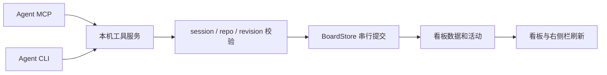

# Phase 2：Agent tools 与 skill 实施合约

2026-10-22 回合清单增量：skill 与实时 get_task 共用简短动作清单，旧会话通过读卡获得最新规则；输出字段为可选的兼容增量，不新增写入闸门。统计脚本同步校准，见 [TURN-CHECKLIST-SPEC](TURN-CHECKLIST-SPEC.md)。

2026-10-22 交付约束增量：交付/结果支持原子登记 outputs，acknowledgeOpen 改为首次拒绝后确认；MCP、CLI 与 skill 同步，见 [DELIVERY-CONSTRAINTS-SPEC](DELIVERY-CONSTRAINTS-SPEC.md)。

2026-10-15 修订（用户要求只对看板管理的 session 提供工具和 skill）：“看板管理的 session” 指两类——从卡片侧栏 Start session 创建（创建前预分配身份并写入凭据，MCP）、或用户在 session 预览中显式点击 “Send Kanban work instructions”（CLI）。`agent.session_open` 只为已有凭据文件的 session 续写环境变量，不再为卡片 workspace 中的其他 session（如普通对话、side chat、原生入口新开的 session）新建凭据。修订前已经写入的凭据文件保留，只能由用户确认后按 session 撤销。

后续单根目录决策见 [SINGLE-ROOT-SPEC.md](SINGLE-ROOT-SPEC.md)：新卡片的工具上下文只使用原生 Paseo project root；已存在多 repo 卡片保留原有只读范围。以下早期多 repo 条款仅用于解释历史行为。

状态：用户已授权实现和完整测试。更新时间：2026-10-13。  
本文件为第二阶段实施合约。基线为修订后的 [Phase 1 spec](PHASE-01-SPEC.md)。

## 1. 目标和确定的决策

Agent 在卡片关联的 workspace 中工作时，能读取当前任务、有效 repo 范围、更新卡片状态并汇报进度。用户在看板看到结果，继续指定 session 工作，最后确认任务完成。

| 项目 | Phase 2 决策 |
| --- | --- |
| 工具范围 | 三个工具：读取当前卡片、更新状态、汇报进度 |
| 新 session | 从卡片侧栏创建时自动带 MCP + skill + 当前任务上下文 |
| 已有 session | 侧栏点击“发送看板工作指示”，向选中 session 提供 CLI + skill；保留已有会话 |
| Agent 状态权限 | 设置 `in_progress`、`blocked`、`in_review`；`done`/`cancelled` 由用户决定，Backlog/Todo 也由用户管理 |
| 多 session | 可以分别汇报、操作同一卡片；状态冲突检测，不自动指定主 Agent、交接或调度 |
| repo 范围 | 每次读取/写入重新核对：未指定为项目当前全部 repo，指定后为所选 repo |
| CLI/MCP 的关系 | 两个入口调用同一个服务、同一套校验、同一个持久化 writer |

用户已授权按此实施并完成测试，包括“Agent 交付到 In review，用户确认 Done”和“已有 session 显式接入”。本阶段不增加自动领取、任务拆解、阶段依赖、自动交接、PR 流程或项目自动完成。

## 2. 继承的关系和边界

- 一个看板 project 对应一个 Paseo project，并保存一个或多个 repo/dir。
- 一个卡片对应一个 workspace；其 session 是这个 workspace 下的零个或多个 session。
- 卡片 `repoPaths=[]` 表示项目当前全部 repo；显式选择一个或多个 repo 时，只把这些目录作为 Agent 工作范围。
- workspace 的启动目录/来源 repo 和任务范围分开。scope 编辑不重建 workspace，也不迁移 session。
- 已有关联 workspace 可保留其他原生 Paseo project 的归属。兼容性通过 Phase 1 的 canonical path/Git common directory 判断；**不能要求原生 project ID 相同**。
- worktree 对应的 repo 使用该 checkout，其他有效 repo 使用项目登记目录。不把一个 worktree 描述为多 repo 的整体隔离环境。
- scope 是任务指示边界，实际读写权限由 provider 决定；工具不提供文件写入沙箱。
- session 的 running/idle/permission/error 和卡片业务状态独立。turn ended、权限请求、session 归档不自动推进卡片。

## 3. 完整使用路径

### 3.1 新 session

1. 用户打开卡片侧栏，选 provider/model/mode、填写初始指示。
2. 插件准备 session：读取当前卡片/project、校验 workspace，预分配 `agentId`，生成仅绑定该 agent/card/workspace 的工具凭据和 CLI context 文件。
3. 通过 workspace SDK 创建 session，传入这个 `agentId`、MCP 配置、skill 指令和 Phase 1 的任务/目录上下文。其他 MCP、provider 选项和权限选择保持正常合并。
4. Agent 开始工作前读取 `flowly_get_task`；它的身份和当前卡片由接入配置确定，不需手填任务 ID。
5. 实际开始工作时设 In progress；途中汇报；完成当前交付时设 In review，列出结果、验证和未完成项。
6. 用户从侧栏继续指示、要求返工或确认 Done。

预分配 ID 是为创建前注入 MCP 提供明确的 session 绑定；不从 cwd/title/label 推断卡片。创建失败时保留草稿和准备信息；重试先确认该 agent ID 是否已经创建，避免重复 session。若已部分创建，展示现有 session 和错误，不自动删除。

### 3.2 已有/从 Paseo 原生入口创建的 session

1. 用户选择目标 session，点击“发送看板工作指示”。
2. 后端核对 session 的实际 workspace、当前卡片与 repo 范围，准备该 session 的 CLI context 文件。
3. 仅向目标 session 发送当前任务上下文、skill 内容及 CLI 绝对路径/context 文件路径；使用现有 Steer/Interrupt 语义，不清空普通 follow-up 草稿。
4. Agent 使用其已有 shell 工具调用 CLI。它读取同一份实时任务上下文，使用同一套状态接口。

不依赖运行中 MCP 热插入。`agent.session_open` 可为明确关联的、interactive session 注入插件专用环境变量，辅助 CLI 发现；它不保证 provider 自动加载 skill，也不自动给所有 session 发 prompt。原生入口创建 session 同样可以通过侧栏显式启用 CLI/skill。

“指示已发送”只证明 Paseo 接受消息；只有实际工具/CLI 调用结果才能显示“已使用看板工具”。

## 4. 状态和多 session 行为

| 工作情况 | 卡片动作 | 汇报内容 |
| --- | --- | --- |
| 实际开始工作 | In progress | 本轮负责的范围和开始事项 |
| 部分进展/一个 repo 完成 | 保持状态，汇报进度 | 已完成部分、其余 repo/任务仍待完成 |
| 本 session 有问题，但整体任务仍可推进 | 汇报 blocker，不自动阻塞整卡 | 影响范围、需要的输入 |
| 整体任务无法继续 | Blocked | 阻塞原因、解除条件、需要用户提供什么 |
| 解除整体阻塞/进入返工 | In progress | 恢复原因或返工要求 |
| 整体交付可供用户检查 | In review | 交付内容、验证证据、未运行项、遗留问题 |
| 用户接受/取消 | 用户设置 Done/Cancelled | Agent 无权通过第二阶段工具代替这一步 |

更新工具允许三种目标状态；源状态为 Done/Cancelled 或归档时拒绝 Agent 写入。Backlog/Todo 到 In progress 是用户已选择并指示该 session 后的显式报告，不代表自动领取。

多个 session 读取到同一版本时，状态修改只有第一个成功，第二个必须重读。不存在自动优先级、“最后写入覆盖”、自动主 Agent 或完成票数。skill 要求每个 session 区分自己的贡献与整卡结果；一部分完成不等于整卡进入 In review。服务只校验结构和当前状态，不能从一句汇报独立证明所有业务工作已完成。

## 5. 实时任务上下文与校验

### 5.1 `flowly_get_task` 返回内容

- 当前 agent/card/workspace 的 ID；卡片标题、描述、状态、优先级。
- project ID/标题、对应原生 Paseo project ID，以及 workspace 实际原生 owner；二者可不同。
- scope 模式 `all`/`selected`、当前有效 repo 列表、每个 repo 的实际工作目录、workspace 启动目录。
- 两个版本号：`revision.task` 与 `revision.project`。
- 最近 20 条活动、Agent 可设置的状态、不可写原因、工具/skill 版本。
- workspace 执行状态及同 workspace 的 session 摘要（ID/title/执行状态，最多 20 条）。使用稳定 workspace ID 筛选 SDK 分页结果；无法完整取得时明确标为 partial/unavailable，不把缺失结果当作“没有其他 session”。这些执行状态只供观察，不作为整卡完成证明。
- 为下一次写入准备的 `request`：唯一 ID 和服务端生成的 `issuedAt`。只读取任务，不预先创建活动或改变状态。

复用 `BoardService.context`、`repoMatcher` 与有效目录映射，避免工具形成另一套目录判断。每次写入都重新读取最新 project；默认全 repo 的卡片在新增/移除目录后立即按新的列表校验。

### 5.2 每次写入的验证顺序

1. 验证接入凭据，解析它固定绑定的 agent/card/workspace；不接受另填目标卡片。
2. 通过 Paseo SDK refresh agent 和 workspace，确认 agent 活跃且其 `workspaceId` 与绑定一致，workspace 可用并仍属于项目 repo。
3. 若同一请求已完成，按第 7 节处理回执；重放不是新写入。已完成/取消或已归档卡片可解释当前不可写状态，不因此重新提交；session 身份或原生资源无效时不放开读取权限。
4. 在 `BoardStore` 的串行 mutation 中重读卡片/project，核对活动状态、未完成状态、task/project 两个版本号，再提交。
5. 返回明确的提交回执和最新上下文。原生资源与本地文件不能组成一个跨系统事务；校验后发生的原生归档会由后续读取/调用发现，不伪称全局锁定。

scope 编辑增加 task revision；项目目录变化增加 project revision。只检查 task revision 会漏掉“默认全 repo”的范围变化，因此两者都参与写入条件。

MCP/CLI 获取的工作目录用于 Agent 当前工作计划。skill 要求开始一个工作阶段前、长时间工作后的汇报前、发生冲突后重读。文件操作不是通过本工具执行，工具不能追溯阻止 Agent 已经按旧指示完成的文件修改。

## 6. 三个工具的合约

MCP server 名称：`flowly`（[命名修订](FLOWLY-NAMING-SPEC.md)）。输入/输出使用共享 Zod 合约，成功结果同时提供 JSON text 和 `structuredContent`。下表不包含手填 agent/card ID，身份由连接配置决定。

| 工具 | 输入 | 效果 |
| --- | --- | --- |
| `flowly_get_task` | 空对象 | 返回第 5.1 节上下文、版本和下一次写入请求 ID |
| `flowly_update_status` | `expectedRevision: {task, project}`、`request: {id, issuedAt}`、`status`、`note` | 校验并变更状态，记录 agent 活动；返回提交回执与当前上下文 |
| `flowly_report_progress` | 同样的版本/request，`note`，可选 `kind: progress/blocker/result`（默认 progress） | 记录活动，不改变业务状态；返回提交回执与当前上下文 |

约束：版本为正整数，note trim 后 1–10000 字符，status 为 `in_progress/blocked/in_review`。未知字段拒绝。输入中粘贴 credential 或另一个卡片的 ID 不会产生跨卡更新。

状态实际变化时增加 task revision；**单纯汇报进度不增加 task revision**，不修改卡片字段或 updatedAt，只增加 board revision 和活动。因此多个 session 的进度记录可顺序追加，不因 note 相互制造状态/表单冲突。进度仍校验读取时的 task/project 版本，避免在用户修改 scope/完成卡片后继续按旧上下文汇报。设置到当前已有状态按一次进度活动处理；最新汇报时间来自活动记录。

活动字段沿用 actor/agentId/note/action/from/to/at，新增可选 `reportKind`；记录实际 agent ID。最近 100 条活动的保留规则沿用 Phase 1。工具注解：读取工具 read-only；写入工具声明会修改本地任务记录，不能标为无副作用。

错误结果使用 `isError: true` 和结构化 `code/message/retryable`，不给出成功回执：

| 错误 | 行为 |
| --- | --- |
| `REVISION_CONFLICT` | 给出当前两个版本，要求重读；不自动覆盖，不自动改用新版本重试 |
| `INVALID_STATUS` / `TASK_FINISHED` | 解释 Agent 状态权限或用户已完成/取消；保留记录 |
| `ARCHIVED` / `RESOURCE_UNAVAILABLE` / `WORKSPACE_INCOMPATIBLE` | 禁止写入，说明具体关联问题 |
| `UNAUTHORIZED` / `SESSION_MISMATCH` | 不泄露其他卡片上下文；禁止写入 |
| `REQUEST_REUSED` / `REQUEST_EXPIRED` | 不提交；说明复用参数不同或需重读获得新请求 |
| `PASEO_UNAVAILABLE` / `TOOLS_UNAVAILABLE` / `STORE_INVALID` | 报告不可用，保留文件；不声称状态更新成功 |

## 7. 冲突、重试和持久化

### 7.1 单一提交路径



`BoardStore` 是唯一 writer，CLI/MCP 不直接改 `board.json`。一次成功提交将卡片变更、活动和请求回执一起原子持久化，然后回应。hook 仍只记录观察事件，不代替工具更新业务状态。

### 7.2 丢失响应和重复请求

- `request` 由读取接口产生，绑定写入 session/card；新请求有效期建议 15 分钟。长时间工作后先重读。
- 回执 key 为 agent ID + 已验证 request ID 的摘要；保存规范化参数摘要、原动作、event ID、提交时版本/状态和时间，不保存原始签名载体或 bearer credential。相同请求/参数重复调用返回原提交回执，标为 `replayed=true`，不重复修改或新增活动。
- 同 key 换 note/status/动作，返回 `REQUEST_REUSED`。不同请求即使 note 相同也是用户/Agent 的另一条合法汇报，不做内容猜测去重。
- 回执建议保留 7 天、全局最多 5000 条。先清理已过期回执；不为了空位驱逐未过期回执，容量不足时拒绝新 Agent 写入并说明原因，人工看板操作仍可用。
- 未找到回执且 issuedAt 超过新请求有效期的旧重试必须拒绝；不能在回执被清理后把旧请求再次当新写入。服务端校验 request 来源/绑定，不能单靠调用者伪填时间绕过过期判断。
- 重复请求返回原提交事实与**当前**卡片上下文，两者分别标明；不把原成功状态描述成“目前仍是该状态”。
- 超时/断连时 Agent 重试相同 request 和参数；收到明确冲突/过期后重读并判断是否还需要动作，不盲目生成新请求重复提交。

`request.id` 是服务端签名的不透明载体，包含唯一 nonce、issuedAt、绑定的 agent/card/workspace 和 task/project 版本。签名覆盖这些字段；另传的 issuedAt/expectedRevision 必须与它一致。调用者复制完整 request，不修改时间或自行拼接 ID。它只用于提交关联，不替代连接身份凭据；签名/凭据不得写入 note、活动或诊断日志。

### 7.3 数据版本

Phase 1 当前数据版本是 **2**。建议 Phase 2 使用版本 **3**，新增 `agentReceipts`，并支持活动的可选 reportKind。保留所有 project/card/关联/repo scope 字段。

读取 v2 时补空回执；v1 先按 Phase 1 迁移为 unrestricted v2，再进入 v3。读取不改磁盘；首次成功 mutation 原子写 v3，上一份文件作为备份。无效/未知版本失败并保留。旧实现不应写回 v3 文件，避免丢失回执。

持久化 schema 与 UI board view 分开：`board.read` 只返回看板所需 project/card/activity/版本，不把内部回执批量送给每个客户端。工具回执通过当前 session 的写入结果返回，避免看板轮询放大 7 天的回执数据。

## 8. 本机服务、身份与运行方式

### 8.1 服务选择

采用 plugin server 中的 loopback HTTP 服务：Streamable HTTP `/mcp` + JSON `/api`。MCP 使用官方 TypeScript SDK；Node adapter 负责 HTTP，业务 service 复用同一个 store。传输采用无会话的请求处理，必要的业务状态都持久化到 store。

监听 `127.0.0.1`，检查 Host/Origin，验证绑定凭据后再处理请求；不开放到其他 host。MCP factory 每次根据已验证身份创建工具集合，不在用户输入中选择 actor/任务。

MCP initialize/tools-list 阶段只验证签名配置，不要求预分配的 agent 已完成原生持久化；否则会形成“连接工具才能创建 agent，但工具要求 agent 已存在”的循环。实际 get/update/progress 调用必须做 live membership 校验。初始 prompt 与原生 agent 保存的时序需 smoke check，早于可用状态时明确返回可重试错误，不跳过校验。

### 8.2 身份配置

后端生成的凭据绑定 `agentId + taskId + workspaceId`，CLI 与 MCP 都使用它。调用时再 refresh 原生 agent 验证真实 membership。MCP 新建 session 的 agent ID 可以在创建前通过 SDK 参数指定，因此不必让模型手填 agent ID。

CLI context 文件按 agent ID 分开，包含该 agent 的绑定凭据和服务发现文件路径，mode 0600。CLI 默认通过 `FLOWLY_CONTEXT_FILE` 或侧栏提供的显式文件路径发现绑定；若有 `PASEO_AGENT_ID`，必须与文件中的 agent 一致。普通终端缺少 session 身份时不提供不受限的人类写入模式。

这些都是同一 OS 用户下的可信本地插件/Agent，不是相互隔离的进程身份系统；credential/membership 校验用于明确调用目标和避免误写，不能证明是谁读取了同用户可访问的文件。

### 8.3 运行文件和 reload

在 plugin data 目录下生成工具 service discovery、私有签名 key、每-session context、独立 Node CLI 和 runtime skill。文件原子写入；目录 0700，私有数据 0600。CLI/skill 路径稳定；不写用户全局 MCP 配置或共享 repo 的 AGENTS.md/全局 skill 目录。

listener 使用持久化的端口和签名 key，reload 后沿用，确保既有 MCP 配置有效。端口冲突不会静默换端口。停止时关闭 listener/handler；保留数据和发现信息。

**工具服务失败不使整个看板失效。** 单独提供 tools health，显示不可用原因；Phase 1 看板/手动状态/普通 follow-up 保持正常。新 session 默认要求工具准备成功；如果不可用，用户可明确选择“创建普通 session”，沿用 Phase 1 行为，之后再接入。不自动删文件或重置 key 修复冲突。

### 8.4 Paseo SDK 上下文的冷启动

0.11.2 的 server entry 没有独立公开 `paseo` 属性；SDK 来自 RPC/hook context。工具 service 从这些 context 接收当前进程的公共 SDK，不依赖 private DaemonClient，不建立第二条 UI 连接。

reload 后、尚未收到 RPC/hook 时，不能伪称原生 membership 已确认。只准备 listener 不代表 tools ready；涉及身份/resource 的调用返回可恢复 `PASEO_UNAVAILABLE`。侧栏 health/prepare RPC、interactive session_open、turn_started 可建立当前 SDK context；接着 refresh 原生资源。已有运行中的 turn 在 reload 瞬间可能需等待下一次 context/重读；不承诺零中断，也不触发额外 prompt 唤醒它。

缓存仅包括当前进程的 SDK API；不把某次 callback 的 `context.signal` 当作长期 service 生命周期信号。HTTP 请求和 plugin cleanup 使用各自的取消机制。

首次 context 获取与 provider MCP 连接顺序是实现前 smoke check 的重点。如果 pinned host 无法支持可靠建立 context，不通过猜 cwd 或跳过 membership 绕过，先修订这一实现路径。

## 9. CLI 设计

CLI 是同一服务的轻量调用器，不是第二个数据库 writer。运行路径由插件返回，例如：

```text
node <plugin-data>/flowly.mjs --context-file <session-context> current
node <plugin-data>/flowly.mjs --context-file <session-context> status in_progress --task-revision 7 --project-revision 3 --request-file <saved-request> --note "开始修改 repo-one 和 repo-two"
node <plugin-data>/flowly.mjs --context-file <session-context> note --task-revision 8 --project-revision 3 --request-file <saved-request> --note "repo-one 已完成，repo-two 仍在修改"
```

`current`（别名 get）输出实时上下文和下一次 request。可通过 `--save-request <path>` 保存非凭据 request/版本快照，便于避免手抄字段；`status`/`note` 可从 `--request-file` 一并读取两个版本，显式版本必须与快照一致。保存文件也是 per-session，不使用共享 cwd 推断身份。

未知/重复 flags、缺失参数、非法状态/版本/request 拒绝。成功 stdout JSON，失败 stderr 结构化错误并非零退出；不打印 bearer token。每次调用重新读取服务发现，HTTP 请求有有限超时。发生超时保留 request，允许按同一参数重试；不能因为进程退出就宣称提交失败或成功。

## 10. Skill 的内容和加载

插件携带 `skills/flowly/SKILL.md`，runtime copy 由同一内容来源生成。名称/description 只指向“在已关联的卡片中读取任务、汇报进度和更新状态”。本轮不生成实际 skill 文件；以下是其内容要求。

1. 先读取当前卡片和有效 repo/checkout 目录，再开展工作；不要把 cwd 当作 repo 范围。
2. 只更新当前连接关联的卡片，遵循第 4 节状态语义。
3. 多 session 的单项贡献使用进度记录，不能据此声称整体完成。
4. 汇报写明结果、验证、未运行项和真正的阻塞；不要凭 turn ended 改状态。
5. 写前用最新 task/project 版本和 request；冲突后重读，解释差异，不能直接覆盖用户修改。
6. 网络结果不明先复用 request 取得原回执，不盲目创建重复动作。
7. repo scope 被用户改窄后，下一阶段按新目录工作；超出实际 provider 权限时报告限制。
8. MCP 可用时使用三个工具；否则使用指定 CLI/context。工具不可用时在回复里说明，不能声称卡片已流转。
9. 整体交付进入 In review；Done/Cancelled 等待用户决定。

新 session 把必要规则嵌入 systemPrompt，给出 runtime skill 路径供详细阅读；已有 session 的明确指示包含必要规则和路径。不能只把 SKILL.md 放在某个文件夹就声称 provider 自动发现成功。实现后使用 skill validator 验证格式，并由 Luna 做真实行为验收。

## 11. UI/RPC 和模块划分

### 11.1 UI 增量

- 新 session 表单说明会携带看板工具；创建后显示其接入方式 MCP/CLI、最近成功调用和工具不可用原因。
- 已有选中 session 显示“发送看板工作指示”，只发送给它；不向所有 session 广播。
- 活动显示 Agent title/ID、动作、note、时间；请求重试不产生重复条目。
- 普通 scope/状态/归档编辑继续使用 Phase 1 接口。新 UI 也必须用 host theme 和 compact 原生布局。
- “配置已提供/指示已发送”与“已成功调用工具”分开显示；不能用一个绿色已启用标记代替执行证据。
- 只读工具的成功调用时间保存在本次运行的内存状态，不为打点改动卡片/board；reload 后若无新调用则如实显示。写入成功可从持久化活动/回执恢复。

### 11.2 新 RPC（设计合约）

| RPC | 用途 |
| --- | --- |
| `tools.health` | listener 和 SDK readiness、非敏感错误/接入版本；不返回 secret |
| `tools.prepare-session` | 输入 card ID + 创建 operation ID；输出预分配 agent ID、scoped MCP config、CLI/skill/context 路径和当前任务上下文 |
| `tools.prepare-existing` | 输入 card ID + agent ID，验证真实 membership，输出对应 CLI/skill 指示和路径 |
| `tools.access-state` | 查询指定 card/session 的配置来源与最近成功调用；不能以配置存在代替 ready |

`tasks.context` 保留，并与 get tool 共用有效 scope/resource 解析。准备 session 的重复 operation ID 返回同一个预分配 ID；如果用户改变创建参数或部分创建失败，先检查现有 session，再决定新操作，保持错误/草稿可审查。

### 11.3 模块责任

| 位置 | 责任 |
| --- | --- |
| `shared/` | 工具/RPC/错误/回执 schema 和状态规则，runtime-neutral |
| `server/agent-service.ts` | 绑定检查、动态 scope、两级版本、状态/进度提交与回执 |
| `server/tool-server.ts` | HTTP/MCP 生命周期、身份校验、health 和 SDK context readiness |
| `server/tool-context.ts` | session 凭据、发现文件和 runtime 文件准备 |
| `server/cli-source.ts` | 生成独立 CLI；只调用 HTTP，不操作 board 文件 |
| `server/store.ts` | v3 读取迁移、串行原子提交、活动/回执持久化 |
| `client/drawer.tsx` | 新建配置、已有 session 显式接入、目标路由和反馈 |
| `skills/` | 插件分发的 skill Markdown；不作为 root code module |
| root entries | 只组合注册和清理；保持既有 client/server 边界 |

## 12. 实施路线和验收

### 12.1 确认设计后的顺序

| 步骤 | 交付 |
| --- | --- |
| S0 | 隔离环境核实预分配 agent ID、provider MCP initialize/首次工具调用和 SDK context 时序；能力不符先修订设计 |
| S1 | Agent service、实时上下文/身份/版本校验、状态规则、v3 回执/迁移 |
| S2 | 本机 MCP/CLI、私有 context、health、reload 和故障隔离 |
| S3 | 新/已有 session UI 接入、session_open env、skill 分发与加载 |
| S4 | Paseo Luna 6 全流程验收、修复、报告，然后停下供用户检查 |

每一步沿用本完整 spec；出现 host/provider 能力变化或产品规则变化时先修订 spec。编码前先核实 SDK agentId 创建参数、MCP provider 连接、context 冷启动时序；不能通过 private API 扩大产品实现依赖。

### 12.2 验收清单

测试阶段使用 Paseo `codex/gpt-6-luna` session，重新发现模型，在创建时明确传入 `settings.modeId: "full-access"`，使用隔离 fixture；测试 session 只负责 verification 脚本/证据，不修改实现或其他人的工作，不重启 daemon。UI 验收只绑定用户的未全屏 Paseo 窗口，先核对真实窗口 ID/标题/几何，绝不操作其正在使用的全屏窗口；无法明确选择时将 UI 项标为未验证，继续非 UI 检查。

1. 新建 session 从真实 UI 取得三个 MCP 工具和 skill；实际 read → In progress → progress → In review，卡片/活动可见，用户确认 Done。
2. 已有 session 显式收到指示，以 CLI 完成同样流程；普通 draft 保留，选中 session 路由正确，不 hot-plug MCP。
3. 默认全 repo 与显式单/多 repo、external worktree 的上下文正确；项目新增/移除 repo 后，旧 project revision 写入被拒绝。
4. linked workspace 原生 owner 不同仍可用；另一个 workspace/session 或同 cwd 的另一个 workspace 不能误认当前卡片。
5. 两个 session 同时写状态仅一个成功；同版本的两个 progress 可追加且不会增加 task revision；人类 scope/状态编辑胜出后旧写入拒绝。
6. 超时后重复 request 只产生一次活动/状态提交；改参数复用 ID、已过期且无回执、容量满都有明确拒绝；reload 保留回执。
7. 归档/已完成/已取消卡片、缺失 agent/workspace、目录不兼容和错误凭据拒绝；turn ended/permission 不自动完成任务。
8. UI 关闭后 Agent 工具仍能工作；reload 中 SDK context 尚未就绪时明确不可用，获得 context 后恢复既有 MCP/CLI。端口冲突只影响 tools，不破坏看板。
9. v1/v2 → v3 保留 repo scope、关联和历史，读取不改磁盘，首次 mutation 备份前一版本；无效数据保留。
10. 新 UI 的宽/窄窗口、浅/深主题、指示发送失败、部分创建及恢复；核心系统只采用真实 tool 调用和 Agent 回复证明闭环。

第一阶段修订后的 compact 检查仍因 CUA 受阻。第二阶段验收必须尝试真实窄屏；工具继续受阻时记录准确未覆盖项，不把旧图片算为通过。旧同路径 duplicate workspace 观察仍未归因；新测试隔离计数，不删除或归因既有资源。

## 13. 依据与本轮结论

已核对本地 `@getpaseo/plugin` / `@getpaseo/client` **0.11.2** types/source：公共 workspace agents.create 接受预分配 agentId 和 MCP 配置；agent.create hook 缺少明确 workspace ID，而 session_open 有 agentId/workspaceId 但只可改 env，因此不从 cwd 做自动卡片识别。参考 [Paseo plugin reference](https://paseo.sh/docs/plugins/reference#before-hooks)、[Paseo Agents SDK](https://paseo.sh/docs/sdk/agents)。

HTTP 服务选型参考官方 [MCP TypeScript HTTP serving](https://ts.sdk.modelcontextprotocol.io/v2/serving/http.md)：无会话 factory、Node adapter、Host/Origin guards 和调用方身份分离。具体包版本在实施时锁定，当前文档不能代替 pinned host 的实际 provider 接入验收。

实现采用官方 MCP v2 Node adapter、Paseo 0.11.2 SDK 和持久化 v3 回执。S0 实际验证了 `codex/gpt-6-luna` 的预分配 ID、`full-access` 与首次 MCP 初始化、工具列表和工具调用顺序；完整产品验收结果记录于 [Phase 2 verification](verification/phase-02.md)。
