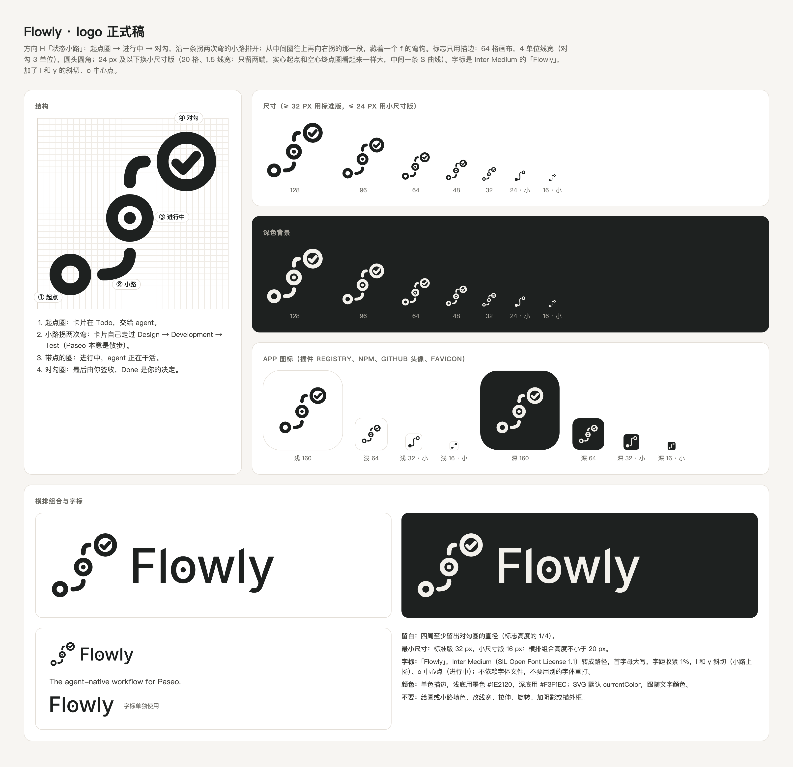

# Flowly logo



标志是「状态小路」：起点圈（Todo，交给 agent）→ 一条拐两次弯的小路（卡片自己走过 Design → Development → Test，Paseo 本意是散步）→ 带点的圈（进行中）→ 对勾圈（最后由你签收，Done 是你的决定）。从中间圈往上再向右拐的那一段，藏着一个 f 的弯钩。

标志只用描边：64 格画布，4 单位线宽，圆头圆角；对勾细一档（3 单位），和圆圈拉开层次。字标是「Flowly」，Inter Medium（SIL Open Font License 1.1）转成的路径，首字母大写，字距收紧 1%，不依赖字体文件；加了和标志呼应的细节：两个 l 的顶端和 y 的尾巴都切成斜角（小路向右上扬的走向），o 里加一个点（进行中的圈）。所有 SVG 都由 `../export-logo.mjs` 生成：标志的几何写在脚本里，字标的轮廓在 `../wordmark.json`。

## 文件

| 文件 | 用途 |
| --- | --- |
| `flowly-mark.svg` | 标志，颜色跟随 `currentColor`（内联到页面时用） |
| `flowly-mark-light.svg` / `-dark.svg` | 浅底用墨色 / 深底用浅色，给 `` 和 README 用 |
| `flowly-mark-small*.svg` | 24 px 及以下的小尺寸版：20 格画布、1.5 单位线宽。三个圈在这么小的尺寸里会糊成一串，所以只留两端：实心起点和空心终点圈，中间一条 S 曲线，两头各留空隙。实心圆比圈小约 13%（直径 5.2 对 6），两端看起来才一样大（2026-10-21 定，对比见 `../logo-drafts/v12-two-ends/` 的 T5） |
| `flowly-wordmark*.svg` | 字标 Flowly（Inter Medium 转路径，加 l 和 y 斜切、o 中心点） |
| `flowly-lockup*.svg` | 标志 + 字标横排：字高为标志的 55%，Medium 的竖笔（约 4.4 单位）和标志线宽（4）接近 |
| `flowly-icon-light.svg` / `-dark.svg` | 512 App 图标（白底 / 墨底圆角方块） |
| `flowly-icon-small-*.svg` | 48 px 及以下的 App 图标，用小尺寸版标志 |
| `png/flowly-icon-{light,dark}-{16…1024}.png` | App 图标 PNG：16、32、48（小尺寸版）、64、128、256、512、1024 |
| `png/flowly-mark-{light,dark}-512.png` | 透明底标志 |
| `png/flowly-lockup-{light,dark}-1200.png` | 透明底横排组合 |
| `favicon.ico` | 16 / 32 / 48 |
| `sheet.html` → `overview.png` | 总览图 |
| `png/flowly-mark-small-{light,dark}-{20,40,60}.png` | 欢迎页标题图标（20 pt）的 1x / 2x / 3x |
| `../../../client/flowly-mark-data.ts` | 上面 6 张 PNG 的内联版（只保留 16 级透明度），客户端按屏幕倍率挑一张原样显示，不缩放；由导出脚本生成，不要手改 |

GitHub README 里按系统深浅色切换：

```html
<picture>
  <source media="(prefers-color-scheme: dark)" srcset="docs/brand/logo/flowly-lockup-dark.svg">
  
</picture>
```

## 使用规则

- 留白：四周至少留出对勾圈的直径（标志高度的 1/4）。
- 最小尺寸：标准版 32 px，小尺寸版 16 px；横排组合高度不小于 20 px。
- 颜色：logo 只用单色，浅底用 `#1E2120`，深底用 `#F3F1EC`；不使用品牌彩色（2026-10-21 定，候选对比见 `../logo-drafts/v7-colors/`）。插件界面里的强调色跟随 Paseo 主题。
- 字标不要用别的字体重打，也不要改字距或去掉细节；要改字标，按下面的步骤重新生成。
- 不要给圈或小路填色、改线宽、拉伸、旋转、加阴影或描外框。
- Paseo 侧栏里的插件图标只接受 Lucide 图标名（现在是 `PanelsTopLeft`），这个标志用不到那里。

## 重新生成

```sh
node docs/brand/export-logo.mjs
```

需要 Playwright 和 ImageMagick（`magick`）。字标轮廓已经存在 `../wordmark.json` 里，平时不用重新生成；要改文字、字重或字距时：

```sh
python3 -m venv /tmp/flowly-fonttools  # Python 3.11–3.15 均可 && /tmp/flowly-fonttools/bin/pip install fonttools uharfbuzz
/tmp/flowly-fonttools/bin/python docs/brand/outline-wordmark.py ~/Library/Fonts/Inter-Medium.ttf Flowly -20 --l-slant --o-dot --y-slant 60 > docs/brand/wordmark.json
```

Playwright 不在模块路径上时用 `PLAYWRIGHT=<playwright 入口>`，自带浏览器缺失时用 `CHROMIUM=<chrome-headless-shell 路径>`。

初稿和探索过程在 `../logo-drafts/`：`v1-filled`（彩色）、`v2-line`（线稿）、`v3-h-as-f`（把 H 改成明显 f 字形的尝试，未采用）、`v4-h-refined`（在原版 H 上的四种优化，正式稿用 R1「精修」；R2「连通」是备选）、`v5-wordmark`（字标的七种写法，选了 W5「Inter Medium · 首字母大写」）、`v6-wordmark-details`（在 W5 上加细节的十种组合，选了 D8「l 斜切 + o 中心点」）、`v8-y-slant`（y 尾巴的收口：圆尾、原样和两种斜切，正式稿用 Y2「斜切 52°」）、`v7-colors`（主题色候选，结论是用单色）、`v9-y-angle`（y 尾巴 52° 和 40° 斜切的对比，定 52°）、`v10-check`（对勾粗细，定 K2：3 单位、放大 12%）、`v11-small`（小尺寸版第一轮：两节点阶梯和三圈细线，未采用）、`v12-two-ends`（小尺寸版两端等大，定 T5：实心起点、空心终点、S 曲线、视觉等大）。小尺寸稿用 `node docs/brand/render-small.mjs <set>` 按真实像素渲染对比图。
